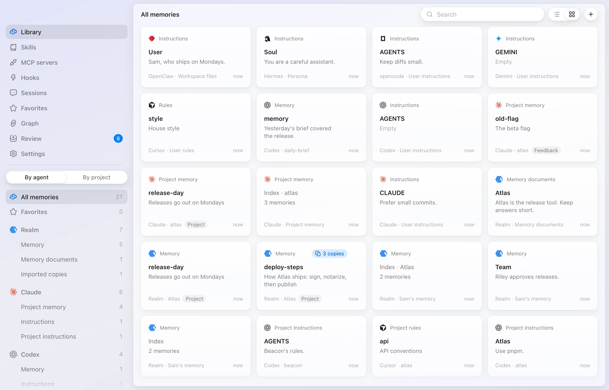

# Stow

One place for what your agents know.

Stow is a Mac app that puts every AI agent's memory, instructions, skills, MCP servers, hooks and
session transcripts in one window, and proposes cleanups you approve. Your files stay where they are.

## Install

1. Download `Stow.dmg` from the [latest release](https://github.com/31Carlton7/stow/releases/latest).
2. Open it and drag Stow to Applications.

Stow runs on macOS 13 or later, on Apple silicon and Intel.

## What it reads

Stow reads the folders your agents already keep in your home folder: Claude Code, Codex, Cursor, Gemini, opencode,
Hermes, OpenClaw and Realm. It lists their memory files, instructions, skills, MCP servers, hooks and
session transcripts, and shows what each agent loads before your first word.

It changes nothing without your approval. An edit to an agent's own file asks first and leaves a
backup, a deleted file goes to the Trash, and every cleanup Stow proposes waits for you to approve
it and can be undone.

## Privacy

- Your files stay on your Mac. Stow has no account and no telemetry, and its index lives in its own
  folder under `~/Library/Application Support`.
- It goes online for two things: an MCP server's icon, from that server's own site, and a skills
  repository you ask it to add.
- A model reads your files only if you switch that on, and then through the `claude` or `codex`
  command you are already signed in to. Stow never touches their sign-in.

## Build from source

You need Node 22.13 or later and pnpm 10.

    pnpm install
    pnpm build
    pnpm dist

`pnpm dist` leaves `Stow.dmg`, a zip and the app in `apps/desktop/release/`. With no signing identity
in the environment the build is unsigned and says so; [docs/dev/signing.md](docs/dev/signing.md) has
the steps for a signed and notarized one. `pnpm dev` runs the app from source.

The icons are [Hugeicons](https://hugeicons.com). The build draws the Pro pack where it is installed
and the free pack, under the same names, everywhere else, so it works with no token.
[docs/dev/hugeicons.md](docs/dev/hugeicons.md) and `packages/ui/src/hugeicons.ts` explain.

## Checks

    pnpm typecheck
    pnpm lint
    pnpm test

The live checks in `apps/desktop/scripts` start the built app in a window nobody sees, on a made-up
home folder, and hold what the window shows against the disk. Run one after a build:

    node apps/desktop/scripts/library-live.mjs

`packaged-live.mjs` does the same for the packed app, after `pnpm dist:dir`.

## Licence

[MIT](LICENSE). Code and artwork taken from elsewhere are listed in [VENDORED.md](VENDORED.md).

Made by Carlton Aikins: [carltonaikins.com](https://carltonaikins.com) and
[@31carlton7](https://x.com/31carlton7).
